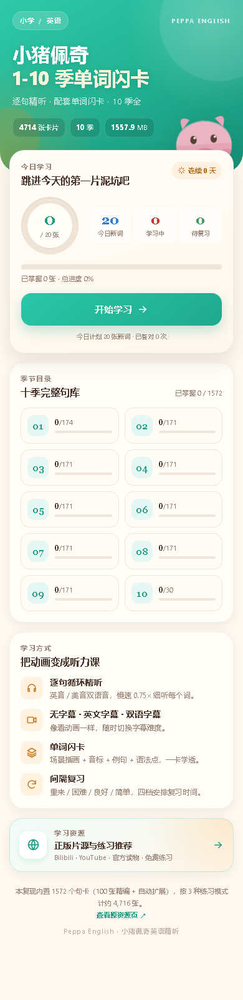

# Peppa English · 小猪佩奇英语精听

一个**纯静态**的英语学习 Web App：以小猪佩奇为主题的逐句精听、单词闪卡与间隔复习体验。

**在线体验：<https://qiyuting0827.github.io/peppa-english/>**

- 纯 HTML / CSS / 原生 JavaScript，**无需构建、无依赖**
- 经典 `<script>` 引入，**双击 `index.html` 即可从 `file://` 打开**
- 5 个视图：首页、精听学习、词库、统计、学习资源；hash 路由，刷新保持当前页面
- **10 季 · 1,572 个句卡**：100 张精编 + 1,472 张自动扩展，按 3 种练习模式计约 **4,716 张卡片**，对齐原资源页 4,714 张的规模口径
- 全部插画为手写内联 SVG，无外部图片/字体
- **预生成神经语音**：英音 Sonia / 美音 Jenny，每句英文/美音 + 单词英文/美音，共 **6,288 条本地 MP3**；慢速用 0.8× 播放，播放失败时才回退 Web Speech API
- 学习进度保存在 `localStorage`（键：`peppa-english-v1`）
- 移动端优先，390–480px 应用栏；桌面端为居中浮起的应用列

> 学习内容为本复现原创的短句与语法讲解，不含原动画字幕或剧照。原卡片资源页：
> <https://file.ankichinas.cn/h5/card/686d3ade63f048ut>



## 打开方式

最简单：双击 `peppa-english/index.html`。

更推荐起一个本地静态服务：

```bash
cd peppa-english
python -m http.server 8137
# 打开 http://127.0.0.1:8137/
```

也可以使用任意静态服务器，例如 `npx serve .`。

## 目录结构

```
peppa-english/
├── index.html                 # 应用外壳，按顺序加载经典脚本
├── README.md
├── screenshot-home.png        # 390px 宽首页截图
└── assets/
    ├── audio/                 # 6,288 条预生成神经语音 MP3（句/词 × 英/美音）
    ├── css/
    │   └── style.css          # 主题、布局、动效、响应式与 reduced-motion
    └── js/
        ├── data.js            # window.PE_DATA：10 季元数据 + 1,572 个句卡
        ├── scenes.js          # window.PE_SCENES：10 种内联 SVG 场景
        ├── store.js           # window.PE_STORE：进度、SRS、localStorage、统计
        ├── views.js           # window.PE_VIEWS：首页/学习/词库/统计/资源
        ├── audio.js           # window.PE_AUDIO：本地语音播放与 TTS 回退
        └── app.js             # 路由、事件、语音、弹窗、自动滚动与快捷键
```

## 季数口径

不同资料对《小猪佩奇》的季数划分并不一致：

- **TVmaze**：9 季 447 集
- **Paramount+ / 国内平台**：常标 10–12 季
- **本应用**：按产品口径展示 1–10 季；**S10 为 2026 新批次**，目前仅部分片名公布

| 季 | 年份 | 集数 | 句卡 | 代表片名 |
| --- | --- | ---: | ---: | --- |
| S1 | 2004 | 52 | 174 | Muddy Puddles, Polly Parrot |
| S2 | 2006 | 52 | 171 | Bubbles, Emily Elephant |
| S3 | 2009 | 52 | 171 | The Rainbow, The Library |
| S4 | 2011 | 52 | 171 | Potato City, Basketball |
| S5 | 2016 | 52 | 171 | The Castle, Gerald Giraffe |
| S6 | 2019 | 52 | 171 | The Panda Twins, Recorders |
| S7 | 2021 | 58 | 171 | America, Sea Treasure |
| S8 | 2023 | 51 | 171 | Grandpa's Robot, Clouds |
| S9 | 2025 | 26 | 171 | Bigger House, New Baby |
| S10 | 2026 | 26 | 30 | The London Marathon, Coach Peppa |

每季已核实的片名列表保存在 `PE_DATA.seasons[].episodes`，每张卡的 `episodeTitle` 均来自对应季列表。1,572 个目标词不重复；100 张精编卡为手写例句，1,472 张扩展卡使用词库（RAZ + Oxford/PEP 常用词）自动生成，抽象词会使用更中性的“单词学习”句式，避免生硬搭配。

## 学习资源

首页底部的「学习资源」进入 `#/resources`，包含：

- [Bilibili 正版英文版](https://www.bilibili.com/bangumi/play/ep375425) — 英文音轨 + 中英字幕，国内首选
- [YouTube @PeppaPigOfficial](https://www.youtube.com/@PeppaPigOfficial) — 整集/合集，需合规网络
- [Paramount+](https://www.paramountplus.com/shows/peppa-pig/) — 10 季打包，英文字幕
- [Netflix](https://www.netflix.com/search?q=peppa%20pig) — 部分地区 6 季
- [Fandom episode list / transcripts](https://peppapig.fandom.com/wiki/Episodes) — 粉丝转录，仅个人参考，勿整段搬运
- [Twinkl Peppa Pig 专区](https://www.twinkl.com/search?q=peppa%20pig) — 官方授权练习（付费）
- [Ladybird Read it Yourself](https://www.ladybird.co.uk/search?q=peppa%20pig) — 官方分级读物
- [iSLCollective Peppa worksheets](https://en.islcollective.com/english-esl-worksheets/search/peppa) — 免费练习

**版权说明**：本应用只用片名、词表与自写例句，不搬运动画转录或剧照。Peppa Pig 及相关角色版权归 Hasbro / 权利人所有；外链指向官方或授权平台，请支持正版。

## 学习流程

1. **听音拼词 / 英文单词 / 中文释义** 三种模式，输入目标单词后「检查答案」。
2. **无字幕 / 英文字幕 / 双语字幕** 可随时切换，选择会持久化。
3. 检查后展示逐字符对错反馈，并自动滚动到卡片背面与评分区：场景插画、音标、词性、例句、翻译、语法点。
4. 用四档按钮安排复习：
   - 重来：box 0，1 分钟后
   - 困难：box 1，6 分钟后
   - 良好：box 2，10 分钟后
   - 简单：box 3，4 天后
5. 键盘：`Enter` 检查、`Space` 显示答案、`1`–`4` 评分、`S` 朗读。
6. 单卡模式（`#/study?item=s1e1-01`）评分后自动返回词库。

## 数据与存储

`PE_DATA.seasons[]` 包含 `n / title / year / episodeCount / episodes / note`；`PE_DATA.items[]` 的每张卡包含：

```js
{
  id, season, episode, episodeTitle,
  word, ipa, pos, cn,
  sentence, sentenceCn, grammar,
  scene // muddy | rain | picnic | beach | snow | night | garden | home | school | boat
}
```

`localStorage` 结构：

```js
{
  items: { "s1e1-01": { box, due, seen, correct, wrong, last } },
  settings: { voice: "UK" | "US", dailyNew: 20, subtitle: "none" | "en" | "both", slow: false },
  daily: { "YYYY-MM-DD": { studied, correct, newCount } }
}
```

`PE_STORE` 暴露 `getCounts()`、`buildQueue(limit)`、`rate(id, level)`、`getItemState(id)`、`getStats()`、`resetAll()` 等接口。

## 验证记录

- 对全部 5 个 JS 文件执行 `node --check`，通过。
- 数据校验：**1,572 个句卡、每季 174/171/30、1,572 个目标词无重复**、目标词在例句中恰好出现一次、`episodeTitle` 均属于该季真实片名、场景 key 全部有效。
- 规模口径：1,572 个句卡 × 3 种练习模式 = 4,716 张；首页保留原资源页 4,714 张的宣传数字，并在页脚说明 100 张精编 + 1,472 张近似扩展。
- 使用 Chromium CDP 在 **390×844 / 390px 视口**渲染并检查：首页、学习正面/背面、答错反馈、词库、统计、资源页、设置弹窗。
- 验证 390×844 下检查答案后自动滚动使 **SRS 评分条完整可见**（评分区 `rateTop 718 → rateBottom 816 < 844`），反馈卡位于 sticky 顶栏下方。
- 验证统计页滚动到底部时页脚位于固定导航上方（页脚底 719.5 < 导航顶 781）。
- 验证词库横向季筛选有右侧渐变箭头提示，滑到末端自动隐藏。
- 浏览器控制台检查：**零 JS 错误**；`file://` 直接打开首页与学习页正常渲染。
- 测试搜索/筛选、模式切换、字幕持久化、答案判定、四档评分、空队列、设置与重置。

## 已知限制

- 原牌组的 4,714 张卡与 1557.9MB 视频属于付费内容，未公开；本应用是**近似全量**：保留主题、季/集结构、听写/闪卡/SRS 体验，但不含原视频与逐字转录。
- 1,472 张扩展卡由词库和句式模板生成，适合泛听泛读，不保证每句都像原动画台词；100 张精编卡为手写内容。
- 语音为 Edge Neural TTS 预生成，不是原动画配音；慢速为 0.8× 变调保持播放。
- 语音质量取决于操作系统/浏览器可用 TTS 声音；本地 MP3 缺失时会回退 Web Speech。
- `localStorage` 在禁用存储/隐私模式下会退化为当前会话内存。
- 复习队列使用需求中的固定间隔，是轻量 SRS 演示，不是完整 Anki 调度器。
- 场景插画为原创简化 Peppa 风格，不是原动画剧照；未使用外部版权素材。
- 资源外链可用性、地区与付费状态由各平台决定。
